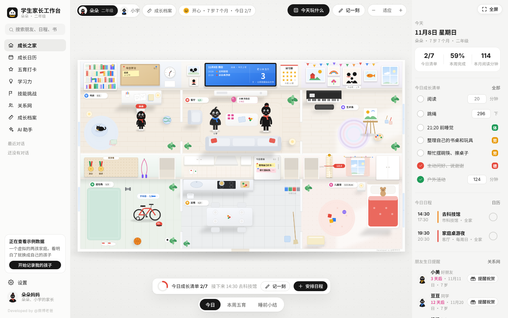
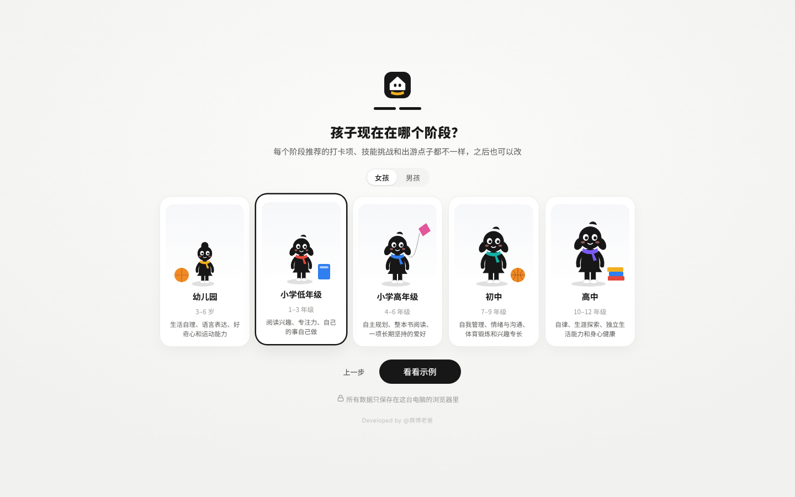
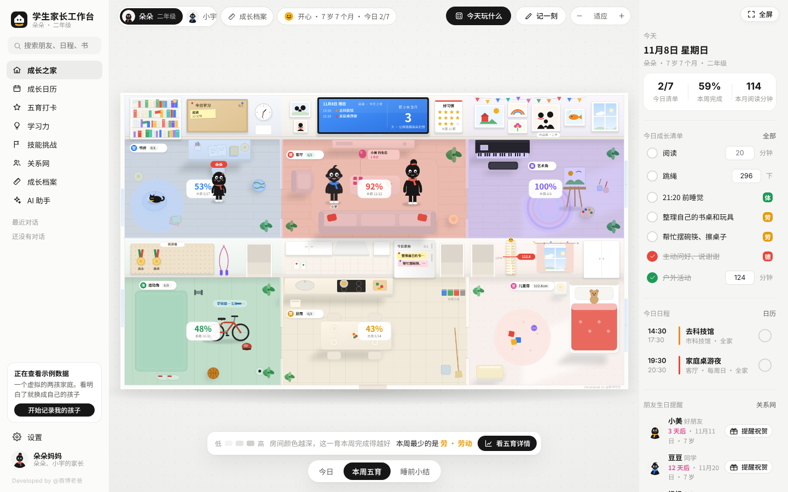
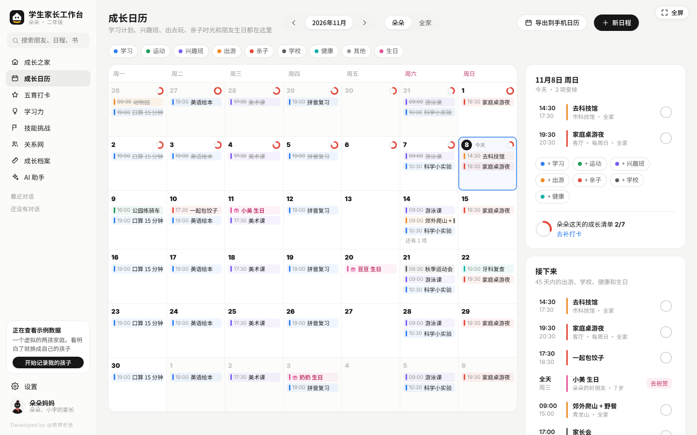
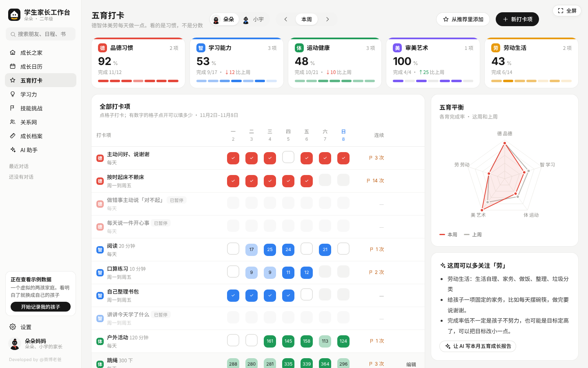
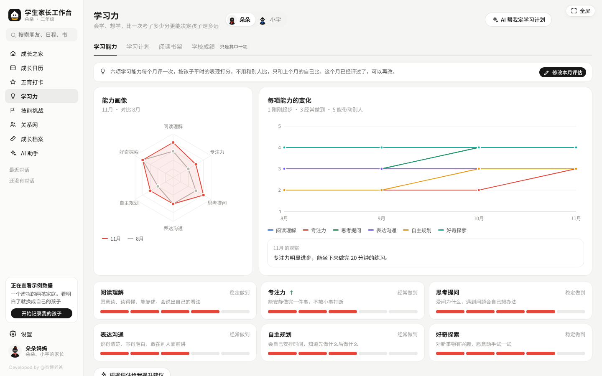
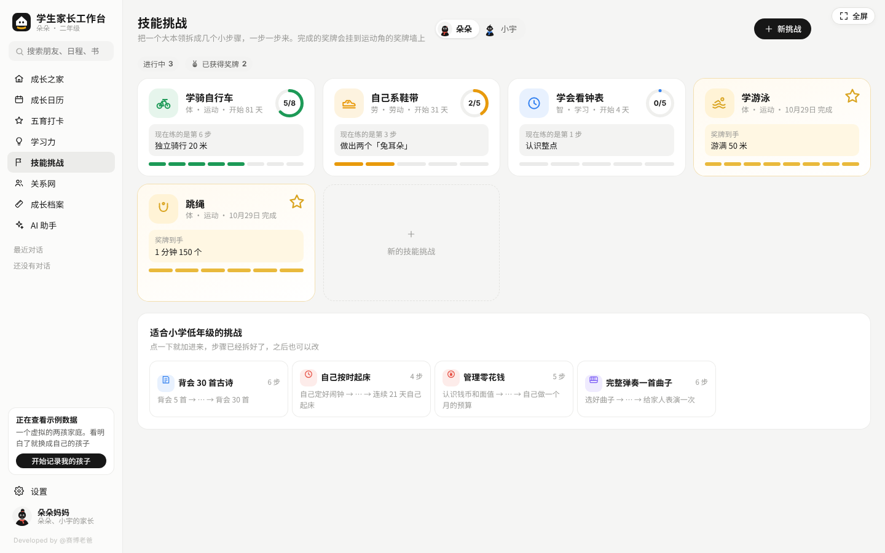
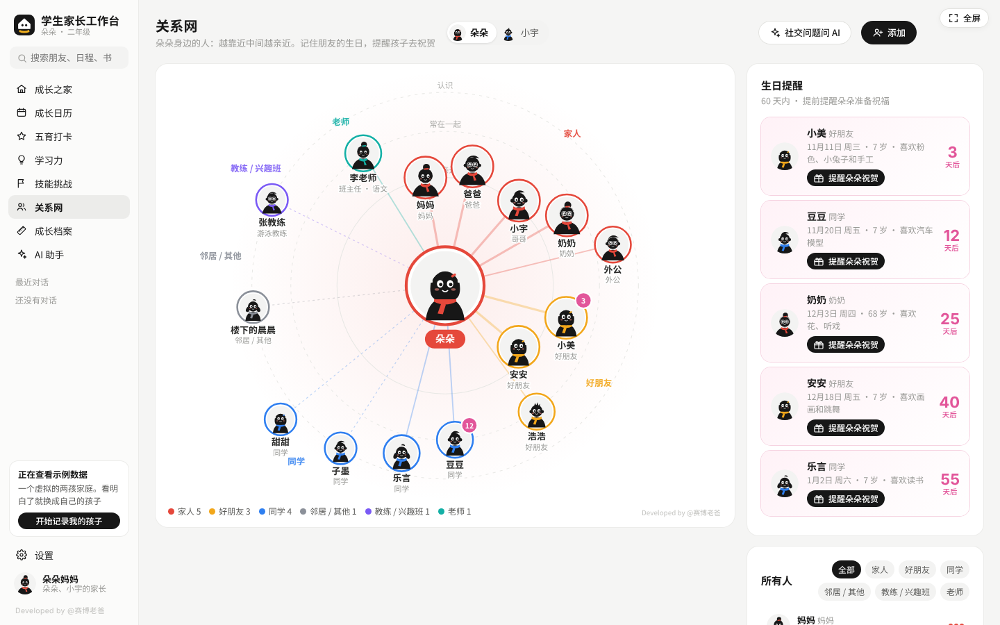
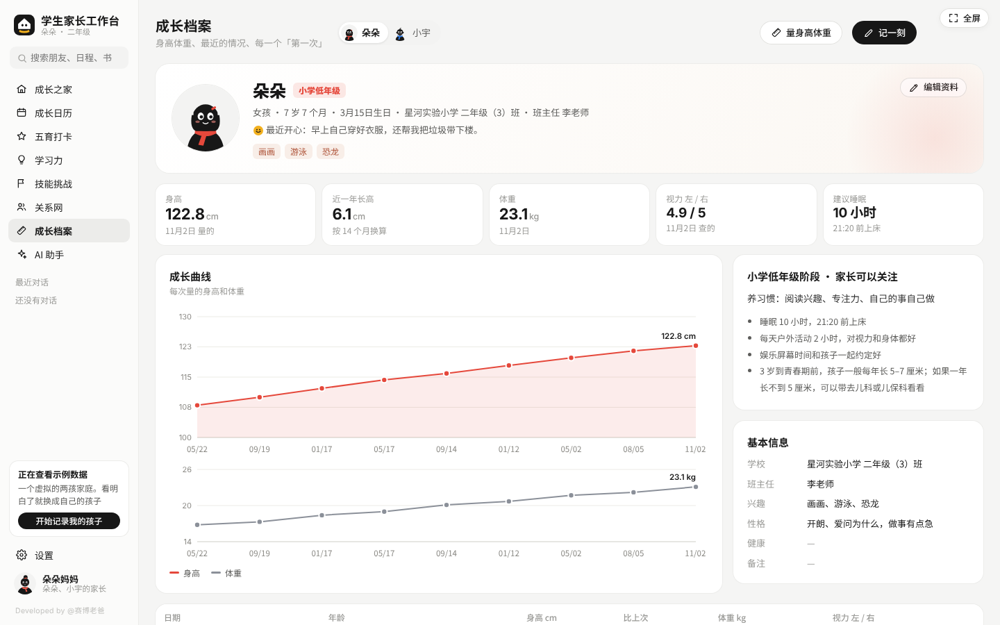
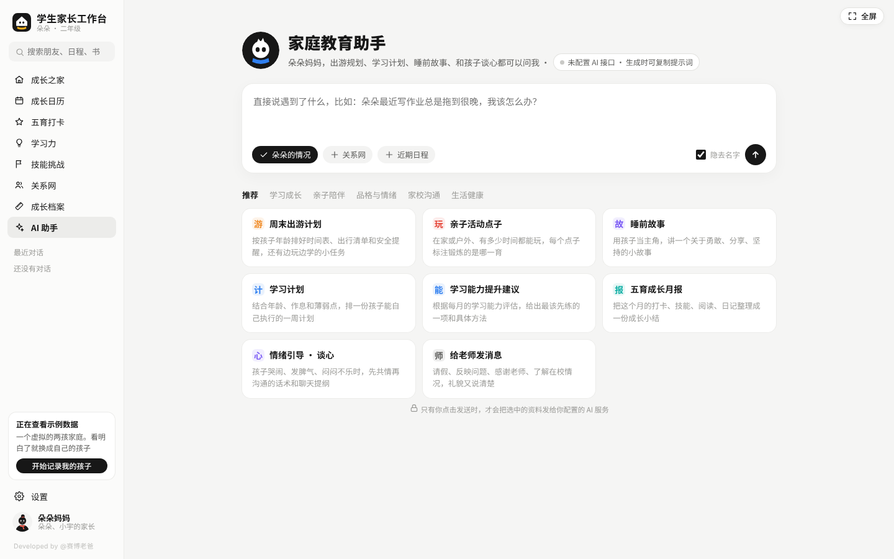

# 学生家长工作台 · workstation-parents

> 个人工作台系列 · v1.0 · PC 源码公开版　｜　Developed by @赛博老爸

给家长用的孩子成长工作台。围绕德、智、体、美、劳五育记录孩子的每一点成长：习惯打卡、学习能力、学习计划、出游和亲子日历、骑车游泳这类技能挑战、孩子的朋友关系网和生日提醒、身高体重成长档案，外加一个可以接入各家大模型的 AI 家庭教育助手。

**学习能力是主线，学校成绩只占其中一项。** 我们想陪孩子长成德智体美劳俱全的人，而不只是一个分数。

一个 `index.html` 文件，双击打开就能用。基础记录功能不用安装、不用注册，断网也能使用，记录默认保存在当前电脑的浏览器里。可选 AI 功能会将问题及相关上下文发送到你配置的服务。

**项目地址：** https://github.com/cyberdaddyleo/workstation-parents  
**新手教程：** [完整使用指南（含示例数据、真实班级配置与 AI 拉取提示词）](docs/使用指南.md)  
**下载项目：** [下载 ZIP](https://github.com/cyberdaddyleo/workstation-parents/archive/refs/heads/main.zip)

本项目公开源代码，个人和家庭免费使用；商业使用须获得授权，许可见 [LICENSE](LICENSE)。



---

## 目录

- [快速开始](#快速开始)
- [功能一览](#功能一览)
- [按孩子阶段推荐](#按孩子阶段推荐)
- [AI 助手（可选）](#ai-助手可选)
- [数据与隐私](#数据与隐私)
- [常见问题](#常见问题)
- [文件说明](#文件说明)
- [使用许可](#使用许可)
- [商用版与合作](#商用版与合作)

---

## 快速开始

1. 点击上方「下载 ZIP」并解压，或在仓库点击 **Code → Download ZIP**。也可以只下载 `index.html`（使用文件页的下载按钮，不要把 GitHub 网页另存为 HTML）。
2. 用 **Chrome** 或 **Edge** 浏览器打开 `index.html`（双击，或拖进浏览器窗口）。
3. 跟着首次欢迎页走三步：
   - **你是孩子的妈妈还是爸爸**：家里只会出现你选的这一位，另一位家长以后可以在「设置 → 家庭」里加上。
   - **孩子现在在哪个阶段**：幼儿园、小学低年级、小学高年级、初中、高中。每个阶段推荐的打卡项、技能挑战和出游点子都不一样。
   - **孩子的基本情况**：名字（必填）、生日、身高、体重、学校、年级，再选一个最近的心情、写一句近况。
4. 点「开启成长之家」，系统会按孩子的阶段自动开好推荐的打卡项。

> 想先看看效果？第一步选「先看看示例」，会按你选的阶段生成一个虚拟的两孩家庭，看明白了在侧栏点「开始记录我的孩子」一键清空。



熟悉 Git 的用户也可以在终端执行：

```bash
git clone https://github.com/cyberdaddyleo/workstation-parents.git
cd workstation-parents
```

然后用浏览器打开目录里的 `index.html`。无需 `npm install`、构建或配置数据库。

### 示例数据与真实班级信息

首次打开默认进入欢迎页，不会直接替你创建真实家庭。「先看看示例」会按所选阶段生成虚拟两孩家庭，包含打卡、日程、技能挑战、关系网和成长记录；「记录我的孩子」则按你填写的资料创建孩子，并启用阶段推荐打卡项。示例仅用于演示。

开始正式使用时，在侧栏点「开始记录我的孩子」，确认清空示例后添加自己的孩子。如果已录入需要保留的数据，请先导出备份。进入「设置 → 孩子」，添加或编辑孩子，填写 **学校、年级、班级 / 班主任** 等真实信息后保存。首次欢迎页只填写学校和年级，班级与班主任可在这里补齐。

班级信息属于孩子档案；本版围绕家庭成长记录设计。已保存的推荐打卡项不会随升学自动替换，可在「五育打卡 → 从推荐里添加」调整。

---

## 功能一览

### 成长之家（首页）

一张俯视的家，六个房间对应五育：

| 房间 | 对应 | 墙上有什么 |
| --- | --- | --- |
| 书房 | 智 · 学习能力 | 学习软木板（今天的学习计划） |
| 客厅 | 德 · 品德习惯 | 家庭日程屏、好习惯星星榜；朋友生日快到时出现礼物和气球 |
| 艺术角 | 美 · 审美艺术 | 作品墙 |
| 运动角 | 体 · 运动健康 | 奖牌墙、身高尺；没学会骑车前，自行车带着辅助轮 |
| 厨房 | 劳 · 劳动生活 | 冰箱贴上的今日家务 |
| 儿童房 | 成长 · 作息 | 睡前小结时孩子会回到这里 |

- 孩子的小人按阶段长高，会在各个房间之间走动；点房间可以看这一项的完成情况，点墙上的东西可以直接跳到对应功能。
- 三种看法：**今日**（今天的清单和日程）、**本周五育**（按完成率给房间染色，一眼看出哪一育偏弱）、**睡前小结**（家里变成夜晚，回顾今天）。
- 右侧是今日成长清单、今日日程和朋友生日提醒，勾选打卡就会同步到家里的墙上。
- 「今天玩什么」随机抽一个适合孩子阶段的亲子点子。



### 成长日历

- 日程分为学习计划、运动、兴趣班、出去玩、亲子时光、学校事务、健康（体检、牙医、疫苗）和其他，颜色区分，可以按类型筛选。
- 支持每天、每周重复（比如每周六的游泳课），某一次去不了可以只取消这一次。
- 出游类日程可以填预算、附带出行清单（带水、防晒、换洗衣服……），玩回来打个分，记下孩子最喜欢的部分和这次学到了什么。
- 关系网里朋友的生日会自动出现在日历上。
- 可以导出 `.ics` 文件，导入手机或电脑自带的日历。



### 五育打卡

- 按德、智、体、美、劳分组的打卡项，可以是「做到就算」，也可以记数量（阅读 20 分钟、跳绳 300 个）。
- 一周表格视图，连续打卡天数、各育本周完成率和上周对比一目了然。
- 五育平衡雷达图，并提示「这周可以多关注哪一育」。
- 每个阶段都有推荐打卡项库，一键添加；也可以完全自定义。



### 学习力

分四个标签页：

- **学习能力**：阅读理解、专注力、思考提问、表达沟通、自主规划、好奇探索六项能力，每月按「刚刚起步 → 能带动别人」五级评一次，看雷达图和变化曲线。
- **学习计划**：一周的学习安排，按天完成打勾。
- **阅读书架**：想读、在读、读完三种状态，读完可以打分、写一句感想。
- **学校成绩**：记录考试各科得分和得分率变化，特意标注「只是其中一项」。幼儿园阶段不显示这一页。



### 技能挑战

把学骑自行车、学游泳、跳绳、自己系鞋带、学会看钟表、独立做一顿早餐、自己坐公交、管理零花钱、当众讲 3 分钟、跑完 3 公里等技能拆成几个小步骤，一步一步完成。每个技能都附带教法小贴士，完成后奖牌会挂到运动角的奖牌墙上。可以自己新建任何技能。



### 关系网

- 以孩子为中心的关系图：越亲近离得越近，按家人、好朋友、同学、老师、教练 / 兴趣班、邻居分组上色。
- 记下每个人的生日、喜好、联系方式和认识的经过。
- **生日提醒**：提前提醒孩子给朋友送祝福，附带适合孩子年龄的祝福话术和礼物点子；送过祝福后标记一下，今年就不再提醒。



### 成长档案

- 身高、体重、视力记录和成长曲线。
- 按阶段显示建议睡眠时长和就寝时间。
- 成长日记：记录心情和一件小事，可以标记孩子的「第一次」（第一次自己骑车、第一次上台……）。
- 孩子的学校、年级、兴趣、性格、健康注意事项等基本信息。



### 其他

- **多个孩子**：顶部一键切换，每个孩子的数据分开记录；家里会同时出现所有孩子。
- **全局搜索**：搜孩子、朋友、日程、书。
- **全屏模式**：适合放在家里的大屏上当成长看板。

---

## 按孩子阶段推荐

| 阶段 | 范围 | 培养重点 | 软件内置作息参考 |
| --- | --- | --- | --- |
| 幼儿园 | 3–6 岁 | 玩中学：生活自理、语言表达、好奇心和运动能力 | 10–13 小时 / 21:00 |
| 小学低年级 | 1–3 年级 | 养习惯：阅读兴趣、专注力、自己的事自己做 | 10 小时 / 21:20 |
| 小学高年级 | 4–6 年级 | 学方法：自主规划、整本书阅读、一项长期坚持的爱好 | 10 小时 / 21:20 |
| 初中 | 7–9 年级 | 找节奏：自我管理、情绪与沟通、体育锻炼和兴趣专长 | 9 小时 / 22:00 |
| 高中 | 10–12 年级 | 定方向：自律、生涯探索、独立生活能力和身心健康 | 8 小时 / 23:00 |

上表列出软件内置的阶段和作息参考值，不替代个体化的专业建议。

阶段会影响推荐的打卡项、技能挑战、出游和亲子点子，以及 AI 助手的回答方式。孩子升学后在「设置 → 孩子」里修改阶段，已有打卡项可再按需要调整。

---

## AI 助手（可选）

不配置 AI 也能正常使用全部记录功能。



### 能帮你做什么

内置 20 个家长常用模板，会自动带上孩子的阶段、近况和相关记录：

- **学习成长**：学习计划、学习能力提升建议、阅读书单、技能怎么教、五育成长月报
- **亲子陪伴**：周末出游计划、亲子活动点子、睡前故事
- **品格与情绪**：情绪引导与谈心、交朋友的问题、生日祝福、习惯养成 21 天、写给孩子的一封信、和青春期孩子沟通
- **家校沟通**：给老师发消息、家长会准备、考试后怎么聊
- **生活健康**：手机 / 平板约定、作息和睡眠、家务分工表

也可以直接自由提问。AI 的回答可以一键存进成长日记。

### 支持的服务

在「设置 → AI 接口」选择服务商，填入自己的 API Key：

DeepSeek、通义千问（阿里云百炼）、Kimi（月之暗面）、智谱 GLM、豆包（火山方舟）、硅基流动、OpenAI、Claude（Anthropic）、Ollama 本地模型，以及兼容 OpenAI `/chat/completions` 格式的服务。以上为内置配置入口，实际可用模型、费用和跨域限制以所用服务为准。

填写「接口地址（Base URL）」和「模型名称」后点「测试连接」。程序会自动追加 `/chat/completions`（Claude 为 `/messages`），不要重复填完整终点路径。「测试连接」会实际请求模型，可能产生服务商费用。

### 没有 API Key 也能用

每个模板都可以「复制提示词」，粘贴到豆包、DeepSeek、Kimi、通义等网页版或 App 里使用。

### 保护孩子隐私

界面默认开启「发送前隐去名字」，会尝试将正文中的孩子和朋友姓名替换为编号。但 **v1.0 的系统提示词仍可能包含家长称呼与孩子真名，不能保证完整匿名**；模板及上下文也可能带上成长记录和日记。使用真实资料前，请确认你愿意将相关信息发送给所选服务商。不希望发送时，可以不配置 API，并在「复制提示词」后自行检查、删去敏感内容。

### 连不上？

有些服务不允许网页直接调用（跨域限制）。可以：

1. 核对服务商的接口地址、可用模型和网页跨域策略；
2. 使用本仓库里的 `ai-proxy.js` 做本地中转：
   ```bash
   # 需要先安装 Node.js 18 或更高版本
   node ai-proxy.js
   ```
   然后把接口地址改成 `http://127.0.0.1:8787/` 加原地址，例如：
   ```
   http://127.0.0.1:8787/https://api.deepseek.com
   ```
   中转只监听本机，不保存、不记录任何内容。

> AI 生成的内容仅供参考。涉及孩子身体健康、心理问题时，请咨询医生或专业人员。

---

## 数据与隐私

- 日常记录默认保存在当前浏览器的本地存储（localStorage）里。使用 AI 时，问题、模板及相关上下文会发送到你配置的服务；使用中转时也会经过该中转。
- API Key 保存在本机浏览器中，调用 AI 时会发送到所配置的接口；导出的完整备份也包含已保存的 API Key。请使用可信的接口和中转地址。
- **请定期备份**：「设置 → 数据与备份 → 导出备份」会下载一个 `.json` 文件；换电脑或换浏览器时用「从备份恢复」导入即可。
- **完整备份包含家庭资料、AI 对话及接口配置（包括 API Key）**，请妥善保存，不要上传公开仓库或分享给无关人员。恢复备份会覆盖当前全部记录。
- 清理浏览器数据或无痕会话结束后，记录可能丢失；若浏览器禁用本地存储，程序会临时使用内存，关闭页面后不能保留。
- 「清空全部数据」及「开始记录我的孩子」会保留家庭与 AI 设置。需要移除 API Key 时，请在「设置 → AI 接口」中另行清空。
- 更换浏览器、文件位置或打开方式后，原记录可能无法读取；建议固定同一浏览器与文件路径，迁移前先备份。

---

## 常见问题

**换了电脑或浏览器，数据怎么带过去？**
在旧浏览器里导出备份，在新浏览器里打开 `index.html`，到「设置 → 数据与备份」点「从备份恢复」。

**能在手机上用吗？**
开源版针对电脑浏览器设计，建议在电脑上使用。手机端和多端同步在商用版里提供。

**家里有两个孩子怎么办？**
在「设置 → 孩子」里添加。顶部可以随时切换当前孩子，每个孩子有各自的打卡、日程、关系网和档案；全家一起的日程可以选择「全家」。

**家里想同时显示爸爸和妈妈？**
到「设置 → 家庭」，在「家里的另一位家长」勾选「在家里显示」。

**示例数据怎么清空？**
侧栏的「开始记录我的孩子」，或「设置 → 数据与备份 → 清空全部数据」。

**孩子升年级了？**
「设置 → 孩子」里修改阶段和年级，推荐内容会跟着变化。

---

## 文件说明

```
学生家长工作台/
├── index.html      # 主程序，单文件，双击即用
├── ai-proxy.js     # 可选：本地 AI 中转（解决部分服务的跨域限制）
├── LICENSE         # 使用许可
├── README.md       # 软件介绍与快速开始
├── docs/
│   └── 使用指南.md  # 详细操作教程与 AI 拉取提示词
└── screenshots/    # 说明用截图
```

`index.html` 不依赖任何第三方库或外部资源，断网也能正常使用（AI 助手除外）。

---

## 使用许可

- ✅ 个人和家庭可以免费使用。
- ✅ 可以阅读、修改源代码，二次开发给自己和家人用。
- ✅ 可以免费分享，但须完整保留许可、作者署名和软件内的「Developed by @赛博老爸」标识。
- ❌ 未经作者书面授权，**禁止任何形式的商业使用**：包括出售软件或修改版、作为付费课程 / 社群 / 会员的一部分提供、由机构用于经营或对外服务、去除署名后发布等。

完整条款见 [LICENSE](LICENSE)。

---

## 商用版与合作

需要以下内容，欢迎联系：

- 商业使用授权（学校、教育机构、托管班、家庭教育服务等）
- 手机端 / 多端同步的商用版
- 定制开发

📮 **cyberdaddyleo@outlook.com**

---

## 个人工作台系列

「学生家长工作台」是 **个人工作台系列** 的一期。系列每期为一种身份或职业打造一个专属工作台，PC 开源版免费开放。

关注 **@赛博老爸** 获取系列其他工作台。

---

<p align="center">Developed by @赛博老爸</p>
